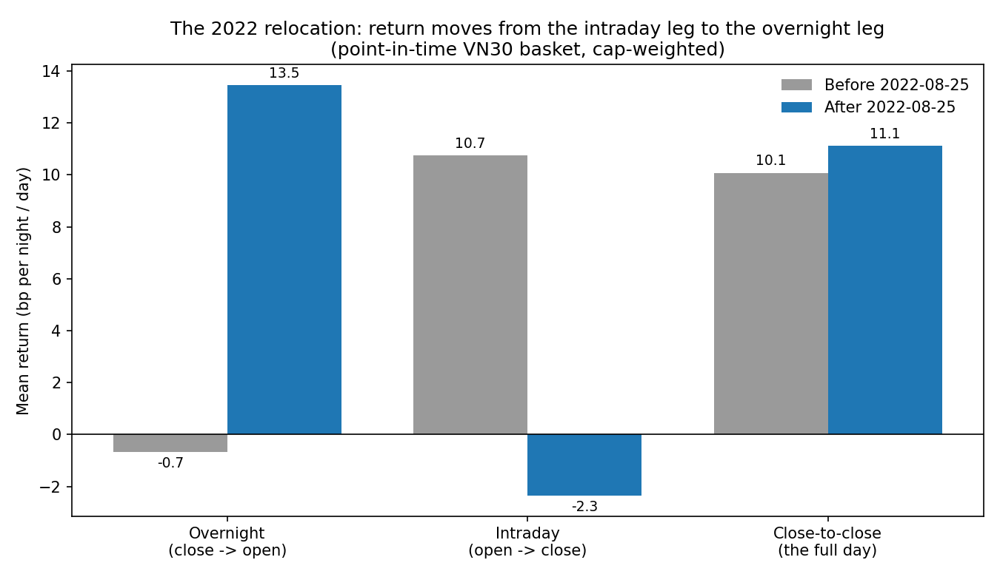
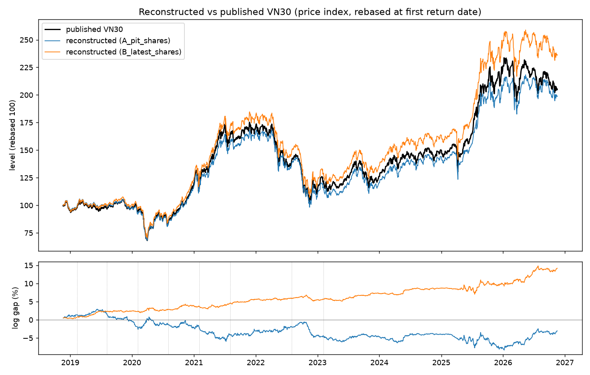
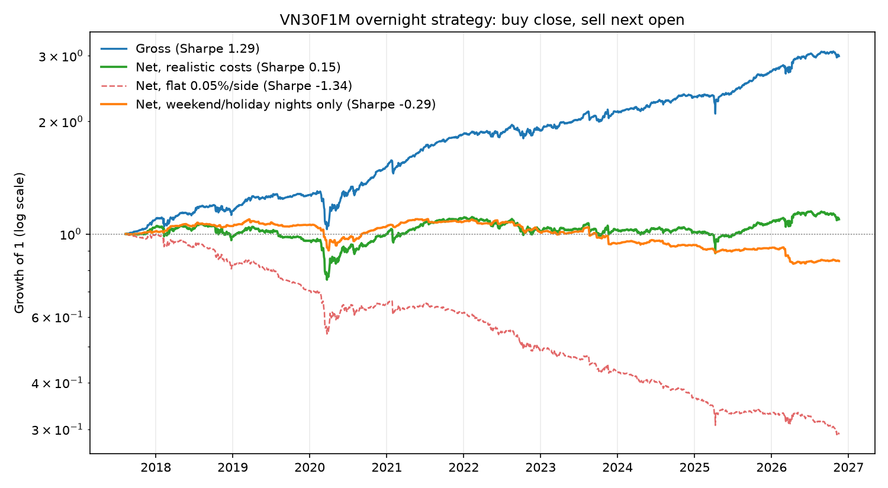
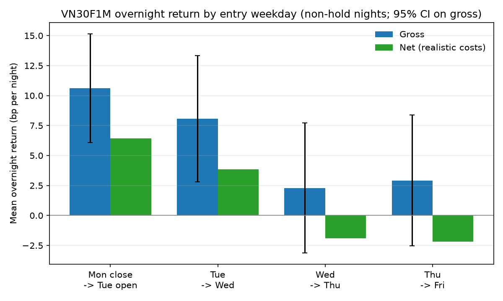

# The Overnight Effect on the Vietnamese Stock Market: Phase 1 + Phase 2 synthesis

Data through 2026-11-25 (forward boundary 2026-11-17, frozen). Generated from CLAIMS_REGISTER.md (claim ids in brackets); every number comes from the results/ file named there, and results/ plus results/LOG.md win over any older file. Measurement only: no trading claim is made.

## 1. The primary question (H1, H2, volatility)
- **VNINDEX, all nights, 2011-2026: the overnight leg beats the intraday leg.** Unfiltered: ON +5.22 bp/night (NW t 4.76), ID -1.89 bp (t -1.16); ON minus ID +7.11 bp (NW t 3.84, 95% CI 3.5..10.7). (The older filtered Level A file gives ON +5.6, ID -1.4 with plain t.) Annualised Sharpe-like ratio 1.51 vs -0.22 (no CI on the difference); median per stock 1.22 vs 0.40. The overnight leg is the calmer one (SD 0.59% vs 1.05%) [C1-C3].
- **The comparison depends on which nights are counted.** On one-day nights alone, ON is still positive (+4.6 bp, t 3.8) but not larger than ID (ON-ID +1.4 bp, t 0.66). Much of the all-nights difference is the trading session after a weekend, which loses about 22 bp (VNINDEX, t -4.7) in both regimes [C30, C31]. Monday index opens are not staler than other opens (flat 5.8% vs 7.4%, Test 1c), so this is not a stale-open artifact as far as tested; the weekend split was examined after the fact (post hoc) [C1, C30].
- **The result is concentrated after 2022-08-25.** VNINDEX ON-ID: before COVID +4.4 bp (t 1.96, at the threshold), 2020-01-23..2022-08-24 -7.3 bp (t -1.4), from 2022-08-25 +21.5 bp (t 6.1). The KRX migration (2025-05-05) shows no separate effect within the post-2022 regime (break t 1.0). EW and CW baskets agree with each other in each regime [C28, C29].
- **China analog (H1-alt, ON <= 0):** not found after 2022; before 2022 the basket overnight leg is indistinguishable from zero (CI about -6.5..4.9 (2026-11-27: 2018-11-21 first-night fix)), so neither confirmed nor rejected [C22].

## 2. The 2022 regime: how firm it is
- On a point-in-time VN30 stock basket, overnight return is about 0 before 2022-08-25 (CW -0.8 bp (2026-11-27: 2018-11-21 first-night fix)) and +13.5 bp after (break +14.3 bp, CI 6.9..21.6 (2026-11-27: 2018-11-21 first-night fix)); intraday goes from +10.96 (2026-11-27: 2018-11-21 first-night fix) to -2.35 bp (break -13.3, CI -23.1..-3.5 (2026-11-27: 2018-11-21 first-night fix)). Close-to-close shows no detectable change (+1.0 bp, CI -9.4..11.4); the CI half-width is about 10 bp and a change of about 15 bp would be needed for 80% power, so smaller changes could not be seen: the data are consistent with a relocation from intraday to overnight [C4, C5].

*Figure 1 — The relocation on the point-in-time VN30 basket. Before 2022-08-25 the overnight leg earns about 0 and the trading day carries the return; after it, they swap, while the full day (close-to-close) barely moves. Return was relocated between legs, not created.*
- **Holds on one-day nights, not produced by weekends.** Restricted to one-day nights, the break is overnight +13.8 bp (t 3.70) and intraday -14.0 bp (t -2.80) for CW, +15.6 / -18.0 bp for EW, with close-to-close about 0. The post-weekend intraday drop (about -26 to -30 bp) is present in both regimes. Whether post-weekend sessions also relocate cannot be told: that cell has 179/201 nights and could only detect a break of about 39 bp (power about 17% for a 14 bp break) [C31].
- **Not a flat-open artifact.** About 27% of stock opens equal the prior close in both regimes (27.3% vs 26.2%); because those nights have ON = 0, the share change can move the overnight mean by about 0.2 bp of the 13.8 bp break (this test's sample, n 741/833 nights, differs slightly from the 740/820 above, hence 13.8 vs 14.3 (2026-11-27: 2018-11-21 first-night fix)). On unflagged stock-days only, the overnight break is +15.6 bp (t 3.85) and the intraday break -14.9 bp (t -2.88); that check drops days on an outcome-related flag, so it supports only this conditional statement, not a level [C4, C5, C27].
- **Survives:** market-state controls for the overnight leg (t 3.81 -> 4.19 (2026-11-27: 2018-11-21 first-night fix)); not the intraday leg with all four controls (t -1.65 (2026-11-27: 2018-11-21 first-night fix)). Three treatments of the 7% rule. Neither the 2018 nor the 2020 drawdown shows the same pattern (low power) [C7, C8, C11].
- **Not pinned:** the break date is not identified (intraday fits 2022-08-26, not detected after Holm adjustment for the CW basket (p 0.166) but detected for EW (p 0.015) (2026-11-27: 2018-11-21 first-night fix); overnight fits 2022-11-25; intervals span about 2021-2024). The T+2 afternoon-sale rule is a candidate cause, untested [C6, C18].
- **Data caveats:** the VN30 index open is degraded 2019-mid 2021, so the stock basket is the reference leg [C19].

## 3. Level B: single stocks and persistence (H3)
- 30 current names: ON positive in 23 (NW t > 2 in 19); ID t < -2 in 3. The current-30 list is survivorship-biased; the PIT basket is not [C10].

*Figure 2 — The point-in-time VN30 reconstruction (two share-count variants) against the published index, rebased to 100: correlation 0.9970 over eight years, drifting only a few percent apart (lower panel). This is the basket the single-stock tests use, which is why they are free of survivorship and look-ahead bias.*
- **Persistence (H3):** stocks with high trailing overnight returns keep higher overnight (+17.9 bp/night top minus bottom third, NW t 10.4) and lower intraday returns (-16.9 bp, t -5.4) next month; the two nearly cancel (close-to-close +1.1 bp, t 0.41). The overnight part halves but survives removing each stock's own mean (+9.1, t 5.3) and a 12-month gap (+9.3, t 4.2). The pre-registered check on unflagged nights fails (t 1.91); it had only 18 of 94 eligible months (all-days spread on those months t 4.59), so it is underpowered rather than a clean rejection, but it does not exclude a flat-open explanation. A post hoc coverage-matched unflagged version (t 9.0) drops nights on an outcome-related flag and is not counted as evidence. The intraday reversal holds at short lags only (12-month lag t -1.5). Supported for the overnight leg; a slow-moving stock-level open effect is not excluded [C9].
- Mon+Tue minus Wed+Thu overnight: +5.3 to +6.6 bp (t 1.55 to 1.98), not significant, chosen after seeing the data [C12].
- Open filter: dropping flat opens selects on the outcome (flagged names close 11.7 bp lower, t -5.77); unfiltered numbers are the reference [C27].

## 4. Phase 2: what can be captured
**Futures (T+0).**
- Always-on VN30F1M overnight: gross +12.9%/yr (t 3.9), net of realistic costs +1.0%/yr (t 0.45): H4 holds for this strategy [C16].

*Figure 3 — The futures overnight strategy (buy every close, sell every open). Gross (blue) compounds to roughly 3x over nine years; realistic costs (green) flatten it to nothing and a slightly higher cost assumption (red dashed) bleeds it away. The edge is real on paper and gone after costs.*
- Futures overnight shows no detected break (post-2022 7.1 bp, t 4.5; break +1.6 bp, CI -3.5..6.8 (2026-11-27: 2018-11-21 first-night fix)); the pre-2022 level cannot be verified (pre-2022-06 opens unverifiable). The paired stock-minus-futures break is +12.6 bp (t 5.1 (2026-11-27: 2018-11-21 first-night fix)). Futures ON is described by index ON plus the change in basis (a = -3.22 bp, k = 0.82), consistent with the index premium and the futures capture diverging [C13, C14].
- Monday-only futures: net 6.4 bp/night (t 2.78; 2022-2025 net 3.6 bp, t 1.57). Chosen after seeing the data: a forward-tracking candidate only, 0 realised forward Mondays (the first, 2026-11-23 -> 11-24, is skipped: the 11-24 bar is in neither VCI nor KBS). Boundary and kill rule unchanged. The old "82% of the Monday edge is basis" is undetermined (48%, CI -88..138%) [C15, C17, C20].

*Figure 4 — Futures overnight return by entry weekday, gross (blue) vs net of costs (green), with 95% confidence intervals on the gross bars. Only Monday and Tuesday survive costs; Wednesday and Thursday are dead or negative. The wide interval on Monday is why it is a forward-tracking candidate, not a result.*

**Stocks under the settlement rule (T+2, Option C).**
- Regime 2 (from 2022-08-25, sale in the T+2 afternoon, 1,052 entry dates): gross 9.0 bp per 2-night hold (NW t 1.30; not distinguishable from 0); net -21 / -31 / -51 bp at 30 / 40 / 60 bp round trip [C23, C24].
- The intraday legs give back most of the overnight edge: about 79% unfiltered (ON 23.5 bp vs ID -18.7 bp per hold); the filtered figures (62% overall, 30% in holds without a weekend) come from an outcome-selected subset and are biased [C25].
- Regime 1 (earliest sale T+3): close-to-T+3-close gross 19.2 bp (t 1.67); net negative at every cost level, significantly only at 60 bp round trip (t -3.53); its return comes from intraday legs, and its leg split relies on unreliable 2019-2021 opens [C26].
- Settlement-rule inputs are unconfirmed against the primary VSD text (behind a login), including T+3 opening-auction sellability in regime 1 [C26a].

## 5. Central story
The overnight premium is real in the index and stock data but regime-dependent: the stock-basket overnight return and the VNINDEX overnight-minus-intraday gap are concentrated after 2022 (VNINDEX overnight was already positive before, +3.9 bp pre-COVID), where stock return moved from the intraday to the overnight leg with no detectable change in daily return, and it is not produced by how often opens are flat. Over the whole sample, part of the overnight-versus-intraday gap is a weekend effect in the intraday session. What can be captured is a different quantity. Futures overnight shows no detected break (its pre-2022 level is unverifiable) and an always-on futures strategy earns about nothing after costs; a settlement-bound stock investor gives most of the overnight edge back intraday and loses money after costs. The gap between the measured overnight premium and what futures or a T+2 investor can capture is the project's Phase 2 result.

## 6. Limits
Break timing and cause are not identified. Pre-2022 futures opens are unverifiable; the VN30 index open is unreliable 2019-mid 2021. Weekend findings and several diagnostics are post hoc and labelled so. Settlement-rule details are from a secondary source. The Monday edge is a forward-tracking candidate with n = 0. Data continuity: vnstock 4.0.4 -> VCI still works and is self-consistent, but v4/v5 are being shut down, no credential-free replacement passed the probe, and the choice of a successor is the user's [C21].

## 7. Not covered (still not done)
- Intraday futures timing (09:00/09:15/09:30): done on 2023-09..2026-11 (pre-2022 still open, no data). No special Wednesday or Monday in the morning basis (W1/W2 fail); the overnight basis shortfall's recovery is inconclusive on one year (T2); futures ON = index ON + basis offset holds (C14). The futures closing auction does not price in overnight drift (auction leg -0.85 bp, t -1.00; hypothesis rejected, P1/P2). A post-hoc one-year lead -- the index's own closing auction lowers its close relative to futures, explaining much of the in-window overnight gap -- is parked for a pre-registered test once more index-intraday history accrues [C14, C32, C33].
- Relocation mechanism at 2022-08-25: tested and inconclusive (cross-section n=30, no significant liquidity/price gradient; mechanism not identified) [C18, PARKED 1]. Verification of pre-2022 futures opens (PARKED 2) and the 2019Q4 anomaly (PARKED 3) remain open.
- Forward validation of the Monday futures candidate: first checkpoint at 30 forward Mondays.
- Primary-source confirmation of the settlement rules (VSD decision text).
- Data-source continuity after the vnstock sunset: user decision (HARD STOP).
