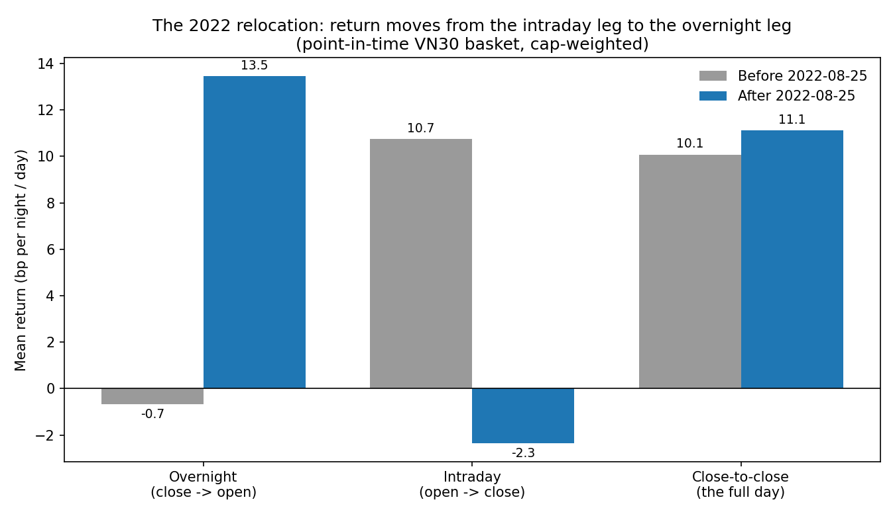
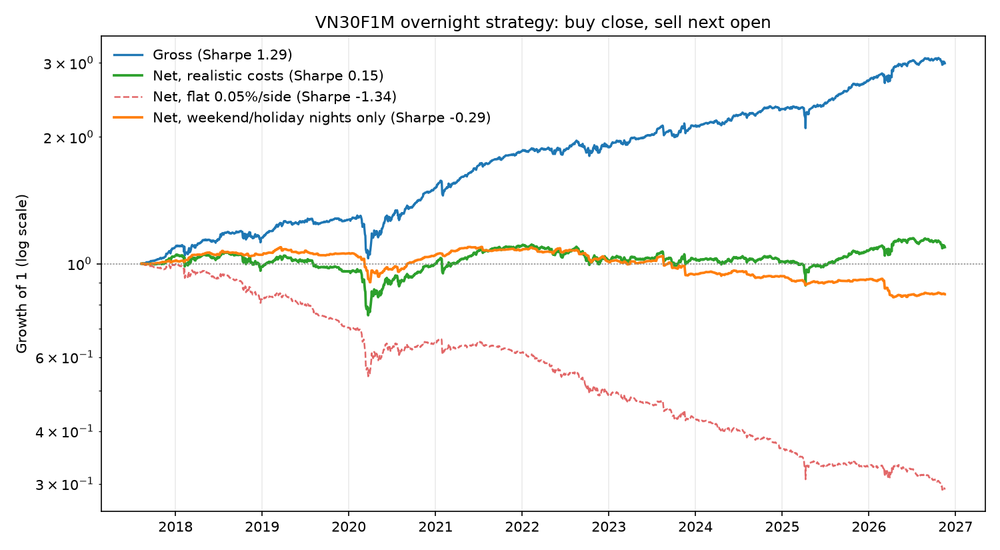

# The Overnight Effect on the Vietnamese Stock Market

A measurement study of close-to-open ("overnight") vs. open-to-close ("intraday") returns on the Ho Chi Minh Stock Exchange (HOSE), 2011–2026, with an executability analysis on VN30 futures and T+2 equity.

**Full write-up:** [Medium post](https://medium.com/@YOUR_HANDLE/POST_SLUG) · **Methodology:** [`docs/design-doc.md`](docs/design-doc.md) · **Every claim with a CI and status:** [`CLAIMS_REGISTER.md`](CLAIMS_REGISTER.md)

## The question

Developed markets earn almost all of their return overnight; China, under same-day-sale restrictions, earns *negative* overnight returns. Vietnam runs T+2 settlement, so its sign was an open empirical question. This project decomposes daily returns into their two legs and asks (1) does the overnight leg beat the intraday leg, also per unit of risk, and (2) can the pattern be captured net of costs?

## Headline findings

- **Over the full sample the overnight leg wins and is the calmer leg** (VN-Index overnight−intraday +7.1 bp/night, t 3.8; Sharpe-like 1.51 vs −0.22). The China-style negative overnight is *not* found.
- **But it is regime-dependent.** On a point-in-time VN30 basket the overnight return is ≈0 before 2022-08-25 and ≈+13.5 bp after — a **relocation** of return from the intraday to the overnight leg, with no detectable change in close-to-close. It holds on one-day nights and is not a flat-open or weekend artifact.



*The headline result: before 2022-08-25 the overnight leg earns ~0 and the trading day carries the return; after it they swap, while the full day barely changes. Return was relocated between legs, not created.*
- **Part of the full-sample headline is a weekend effect:** on one-day nights alone the overnight−intraday gap is not significant (+1.4 bp, t 0.66).
- **The effect is hard to capture.** An always-on VN30 futures overnight strategy nets ≈0 after costs; a Monday-only version is an unvalidated candidate now tracked live. A T+2 equity hold gives ~79% of the overnight edge back intraday and loses money after costs.



*The executable side: a VN30 futures overnight strategy is strong gross (blue, ~3x) but nets to nothing after costs (green). You can measure the premium; you mostly cannot capture it.*
- **Not settled:** the exact break date (interval ~2021–2024) and its cause are open.

## Repository layout

```
src/            analysis scripts (decomposition, PIT rebuild, audits, futures, Option C)
results/        computed outputs (CSVs) and per-audit notes, incl. results/LOG.md
docs/           design-doc.md (methodology), progress report
data/           point-in-time membership + sector maps (see data/README.md for raw-data sourcing)
CLAIMS_REGISTER.md   31 claims, each with evidence file, CI and status
FINAL_REPORT.md      Phase 1 + Phase 2 synthesis
pit-vn30-rebuild-spec.md   spec for the validated point-in-time VN30 replica
requirements.txt
```

## Reproducing

```bash
pip install -r requirements.txt
# Raw price/futures data is not committed (see data/README.md); fetch it first, then:
python src/level_a.py            # index decomposition
python src/level_b_rebuild.py    # single stocks + 2x2, symmetric 7% rule
python src/level_c_futures.py    # VN30 futures
# results/ is regenerated by the scripts above and the audits in src/
```

## Data

Raw daily OHLC for the indices, VN30 constituents and VN30F1M/F2M futures comes from the `vnstock` library (VCI/KBS sources) and is **not redistributed here** (size and vendor terms). See [`data/README.md`](data/README.md). The committed `data/` files are our own compiled point-in-time VN30 membership, sector groups and universe list.

## Caveats

This is a **measurement** study, not a trading system and not investment advice. Pre-2022 futures opens are unverifiable; the VN30 index open is degraded in 2019–mid-2021; the settlement-rule primary source is unconfirmed; the Monday futures candidate has zero forward observations. See `FINAL_REPORT.md` §6–7.

## Author & license

Harry Nguyen. Released under the MIT License (see [`LICENSE`](LICENSE)).
