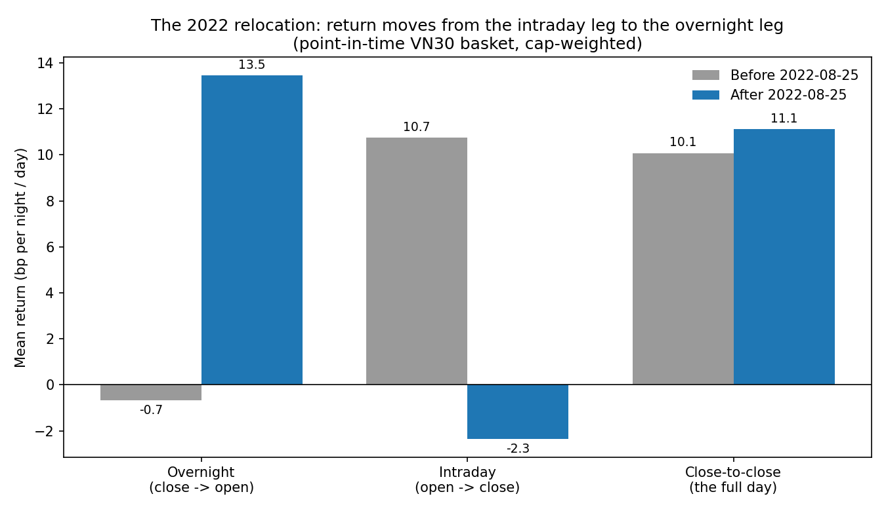
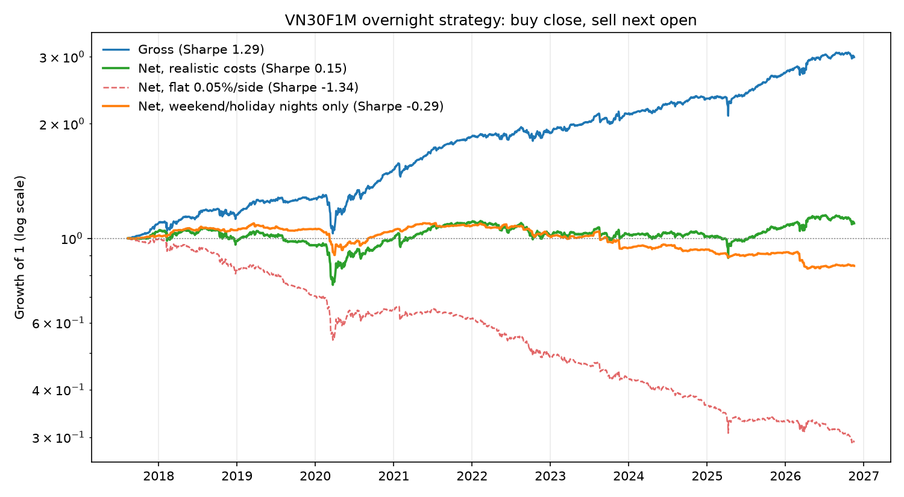
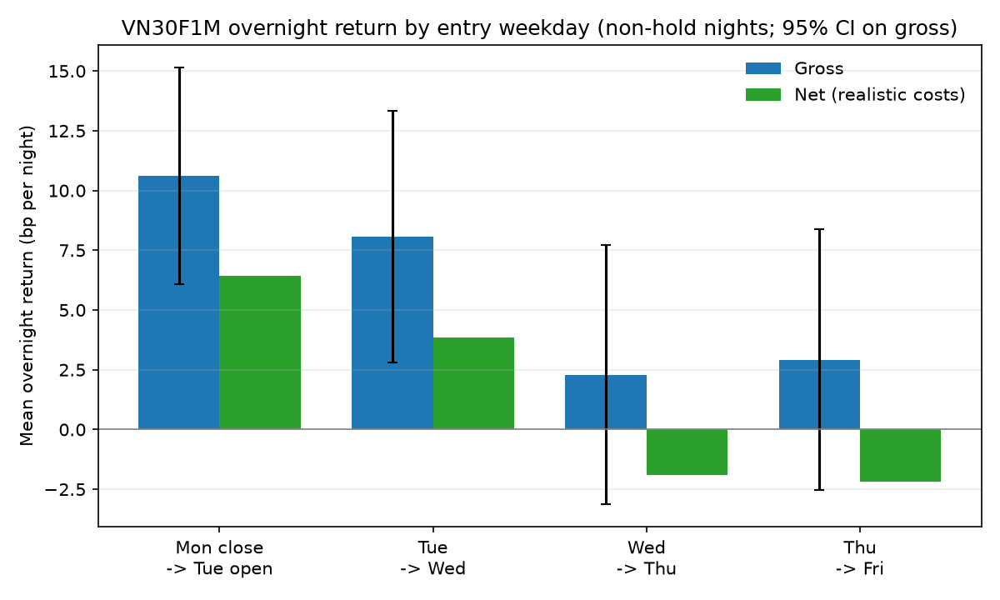
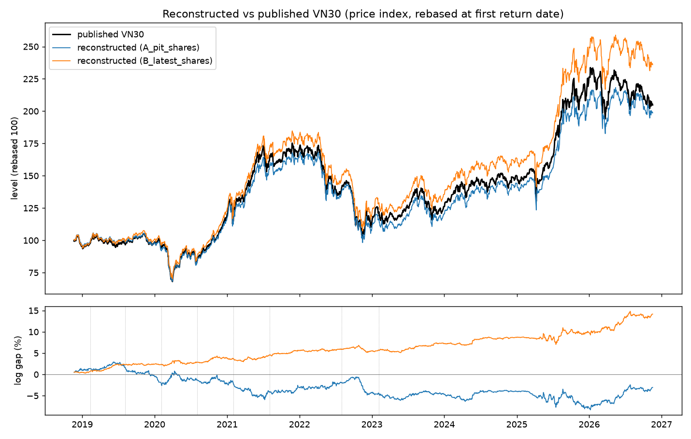

# The Overnight Effect in Vietnam: Real, Regime-Dependent, and Hard to Capture

*A measurement study of close-to-open vs. open-to-close returns on the Ho Chi Minh Stock Exchange (HOSE), 2011–2026.*

---

## Where this started

I spend most of my time looking at Vietnamese capital markets, and this project began with a mismatch: something the global literature treats as almost a law of markets, set against a market — my own — that nobody had checked it against.

The "something" is the **overnight effect**. In the United States and most developed markets, essentially all of the stock market's long-run return has accrued *overnight*, from one day's close to the next day's open, while the open-to-close trading day has contributed almost nothing. It sounds like a measurement glitch, and it has survived decades of scrutiny.

## What the research actually says

The idea that the two sessions are different objects goes back to French and Roll (1986), who showed that stock-return variance is far higher when the market is open than when it is closed — information and trading, not just elapsed time, drive volatility. That reframes a daily return as two unlike things: a quiet overnight gap and a noisy trading session.

The modern, more startling version is empirical. Cliff, Cooper and Gulen documented that in the US the entire equity premium, historically, has been an overnight phenomenon — hold the market only during trading hours and you earn roughly nothing. Lou, Polk and Skouras (2019), in the *Journal of Financial Economics*, pushed this further: they decomposed fourteen well-known return anomalies into overnight and intraday pieces and found each one lives almost entirely in one session or the other — momentum overnight, many others intraday — with an offsetting reversal across the two that persists for years. They attribute it to a "tug of war" between investor clienteles who prefer to trade at the open versus through the day. Across developed markets the overnight leg beats the intraday leg with striking consistency.

Then comes the exception that makes Vietnam worth studying. In China, overnight returns are on average **negative** — the opposite result. Zhang (2020) shows the Chinese overnight return is significantly negative while T+0 venues that track the same market (index futures, Hong Kong-listed shares, international indices) sit near zero, and argues the overnight return there is essentially a proxy for the trading mechanism itself. Qiao and Dam trace the cause to the **T+1 rule**, which forbids selling a share on the day you buy it: that one-sided restriction imposes a discount on the opening price, which they estimate at about **14 basis points**, showing up as a negative overnight return. Later work (An, Huang and Li, 2022) finds the Chinese anomaly is asymmetric, concentrated after down days.

So the literature offered two sharply different pictures, and the line between them looked a lot like **settlement**: instant-sale (T+0) markets earn positive or zero overnight; the one big T+1 market earns negative.

## The question I kept asking

Vietnam sits right on that fault line. The Ho Chi Minh Stock Exchange is a frontier, retail-dominated market, and it runs **T+2 settlement** — you cannot sell a share until two days after you buy it, a restriction closer to China's than to the US's. As far as I could find, nobody had decomposed Vietnamese returns this way. So the opening question was genuinely open: would Vietnam look like the developed world (positive overnight), like China (negative overnight), or like neither?

That single question kept splitting into sharper ones, and the project is really the record of that splitting:

- Does the overnight leg even differ from the intraday leg in Vietnam? *(the raw question)*
- If it does, does it survive **risk adjustment** — is the overnight leg better *per unit of volatility*, or just bigger? *(what separates a real anomaly from mere compensation for overnight-gap risk)*
- Is Vietnam a China-style reversal, with a **negative** overnight leg driven by T+2?
- Does the pattern **persist** at the level of individual stocks, the way Lou–Polk–Skouras find in the US?
- And the one that matters for anyone tempted to act on it: does any measured edge survive **real trading costs**?

The answers turned out stranger than any of those three guesses, because the honest reply to the very first question is "it depends when you ask" — the effect switches on around 2022 — and that discovery reorganized the whole project. The rest of this piece is what those questions returned.

## What we measured

Every daily return splits exactly into two legs, in logs:

- **Overnight:** `ln(Open_today) − ln(Close_yesterday)`
- **Intraday:** `ln(Close_today) − ln(Open_today)`

We computed each leg's mean, volatility, Sharpe-like ratio and significance across three levels:

- **Level A — the indices** (VN-Index back to 2011, VN30 back to 2018).
- **Level B — individual stocks** (the VN30 constituents, rebuilt point-in-time to avoid survivorship bias).
- **Level C — VN30 futures** (VN30F1M, the one instrument where the overnight trade is actually executable, since futures settle T+0).

The study is deliberately framed as **measurement first**. Whether the pattern exists is a different question from whether you can trade it, and mixing the two is how people fool themselves. Tradability got its own phase.

A note on rigor, because it is the point. Decision rules were pre-registered in each script's header *before* the run. Inference uses Newey–West and block-bootstrap standard errors. Multiple-comparison bars (Bonferroni) were applied to the weekday grids. Every single number in this write-up is tied to a claim in a public register, each with a confidence interval and a status of *supported*, *undetermined*, *untestable* or *retired*. Several of our own early conclusions ended up *retired* — more on that below.

## Finding 1: the overnight leg wins — but read the fine print

Over the full VN-Index sample (2011–2026), the overnight leg beats the intraday leg, and it does so as the *calmer* of the two:

- Overnight: **+5.2 bp/night** (t = 4.8)
- Intraday: **−1.9 bp/day** (t = −1.2, not significant)
- Difference: **+7.1 bp** (t = 3.8)
- Annualised Sharpe-like ratio: **1.51 overnight vs −0.22 intraday**; overnight volatility is *lower* (0.59% vs 1.05% daily).

So on the headline, Vietnam looks like a developed market, not like China. The China-style negative overnight does not appear.

But the honest version is narrower. When you drop weekend-spanning nights and look only at ordinary one-day nights, the overnight-minus-intraday gap collapses to **+1.4 bp (t = 0.66)** — not significant. A large part of the full-sample difference is a **weekend effect**: the trading session right after a weekend loses about **22 bp** on average. That is a real feature, but it is not the clean "overnight always wins" story the headline implies, and we flag it as a post-hoc discovery rather than something we set out to test.

## Finding 2: the effect is regime-dependent — and 2022 is the hinge

This is the central result. The overnight premium is not a constant of the Vietnamese market. It switches on.

On a point-in-time, free-float cap-weighted VN30 stock basket (validated to track the published index at a correlation of **0.9970**), the overnight return is **indistinguishable from zero before 25 August 2022** and **about +13.5 bp per night after it**. And it is not a free lunch appearing from nowhere — it is a **relocation**:

| Leg | Before 2022-08-25 | After | Change |
|---|---|---|---|
| Overnight | ≈ 0 | +13.5 bp | **+14 bp** (t 3.8) |
| Intraday | +10.8 bp | −2.4 bp | **−13 bp** (t −2.8) |
| Close-to-close | — | — | **≈ 0** (not detectable) |

*Figure 1 — Before 2022 the overnight leg earned nothing and the trading day carried the return. After 25 August 2022 they swap places, while the full-day (close-to-close) return barely changes. Return was **relocated**, not created.*

Return moved out of the trading day and into the overnight gap, with no detectable change in the total daily return. The same split holds on one-day nights alone (overnight +13.8 bp, intraday −14.0 bp), so it is not a weekend artifact. It is also not an artifact of "flat" opening prices: the share of opens equal to the prior close barely moves across the break (27% to 26%), and that change can account for only about 0.2 bp of the 14 bp shift. The overnight break survives controls for market trend, volatility and turnover.

Date-stamped: VN-Index overnight-minus-intraday is +4.4 bp pre-COVID (t 1.96), −7.3 bp through the COVID period, and **+21.5 bp from late August 2022 (t 6.1)**.

What we **cannot** claim: we could not pin the break to a single date. Change-point tests put the overnight break anywhere in a wide window spanning roughly 2021–2024, and the intraday break lands around 2022-08-26. The timing coincides with the day HOSE moved to afternoon-of-T+2 sale availability, which is a tempting candidate cause — but we did not test the mechanism, and the interval is too wide to pin it. We report the relocation as a fact and the settlement change as a hypothesis, not a conclusion.

## Finding 3: can you actually capture it? Mostly no

A premium you cannot trade is a curiosity, not an edge. Phase 2 tested the two realistic ways to try.

**Futures (VN30F1M, settle T+0).** This is the one place the overnight trade is literally executable. A strategy that buys every close and sells every open earns a healthy *gross* **+12.9%/yr (t 3.9)** — and then dies on costs, netting about **+1.0%/yr (t 0.45)**, indistinguishable from zero. 

*Figure 2 — The futures overnight strategy (buy every close, sell every open). Gross (blue) compounds to roughly 3× over nine years; realistic costs (green) flatten it to nothing, and a slightly higher cost assumption (red dashed) bleeds it away entirely. The edge is real on paper and gone in practice — the whole point of separating measurement from tradability.*

A narrower **Monday-only** version is more interesting: net 6.4 bp/night (t 2.78) over the full sample. But strip out 2026 and it drops to 3.6 bp (t 1.57) — not significant. It is a *candidate*, not a validated edge, and it is now being tracked forward live with a frozen boundary and a pre-registered kill rule. Zero forward observations so far; a real verdict is years away.

*Figure 3 — Futures overnight return by entry weekday, gross (blue) vs net of costs (green), with 95% confidence intervals on the gross bars. Only Monday and Tuesday survive costs; Wednesday and Thursday are dead or negative. Monday is the forward-tracking candidate — and notice how wide the confidence interval is. That width is why this is a candidate, not a conclusion.*

Why do futures capture so little of the index's overnight premium? Because the futures overnight return equals the index overnight return *plus the overnight change in the basis*, and post-2022 the basis systematically narrows during the day — futures under-react to the overnight move and catch up intraday. In 2025 the index earned ~16.7 bp overnight while futures captured ~6.4.

**Stocks under the settlement rule (T+2).** If you buy a basket at the close and hold until you are allowed to sell, the gross return is **+9.0 bp per hold (t 1.30)** — already indistinguishable from zero — and costs turn that into **−21 to −51 bp** depending on the fee assumption. The reason is mechanical: holding through the mandatory T+2 window means you also sit through the intraday legs, which hand back about **79%** of the overnight edge. The equity version is not executable.

**The Phase 2 result, in one line:** the overnight premium is real in the index and the stocks, but the gap between that measured premium and what any instrument can actually keep after costs is large. You can see it; you mostly cannot have it.

## What we could not settle

Stated plainly, because a measurement study is only as honest as its limits:

- **When and why the 2022 regime changed.** The date is not identified and the cause is untested.
- **Whether the Monday futures edge is real.** Zero forward observations; the in-sample case leans heavily on 2026.
- **Pre-2022 futures opens** are unverifiable, and the VN30 index open is degraded in 2019–mid-2021 (which is why the stock basket, not the index, is the reference leg early on).
- **The primary settlement-rule text** (the VSD decision) sits behind a login and was not confirmed against the secondary sources used.

## How it was built, and how to check it

Everything is reproducible and auditable:

- A **point-in-time VN30 reconstruction** (free-float cap weights, 10% cap) validated at 0.9970 correlation to the published index, so the stock tests are free of survivorship and look-ahead bias.
- A **roll-gap repair** that recovered 14 missing futures roll days from per-contract tickers, and an **open-definition audit** that flagged and bounded stale opens — 20–38% of stock-days carry an open equal to the prior close, which, left unhandled, inflates the overnight leg.
- A **claims register**: 31 claims, each with evidence file, confidence interval and status. Where the data forced it, claims were retired — including an earlier "82% of the Monday edge is basis" figure (now undetermined, 48% with a confidence interval from −88% to +138%) and an earlier index-based regime story (re-based on the stock basket once the index open proved unreliable).
- Frozen, hash-verified data snapshots so results reproduce bit-for-bit.

*Figure 4 — The point-in-time VN30 reconstruction (blue and orange, two share-count variants) against the published index (black), rebased to 100. The replica tracks the real index at a 0.9970 correlation over eight years; the lower panel shows the two variants drift only a few percent apart. This is what lets the single-stock tests avoid survivorship and look-ahead bias — the reconstruction is a faithful stand-in for the index the futures actually track.*

The full methodology, results tables and the claims register are in the repository.

## Takeaways

1. **Vietnam looks developed, not Chinese** — the overnight leg carries the return and is the calmer leg — *but only since about 2022, and partly as a weekend effect over the full sample.*
2. **The headline finding is a relocation, not a windfall.** After 2022, return moved from the intraday session to the overnight gap with no detectable change in the daily total.
3. **You can measure it; you mostly cannot trade it.** Futures capture well under half of it and net to zero after costs; the T+2 equity version loses money.
4. **The interesting open question is "why 2022?"** — a question this study frames but does not answer.

---

*Data via `vnstock` (VCI/KBS). This is a measurement study, not investment advice. Code, data notes and the full claims register: [GitHub repository]. Methodology design doc and progress report included in the repo.*

### References
- French, K. R. & Roll, R. (1986). Stock return variances: The arrival of information and the reaction of traders. *Journal of Financial Economics* 17(1), 5–26.
- Cliff, M., Cooper, M. & Gulen, H. Return differences between trading and non-trading hours (working paper).
- Lou, D., Polk, C. & Skouras, S. (2019). A tug of war: Overnight versus intraday expected returns. *Journal of Financial Economics* 134(1), 192–213.
- Zhang, B. (2020). T+1 trading mechanism causes negative overnight return. *Economic Modelling* 89, 55–71.
- Qiao, —. & Dam, L. (2020). The overnight return puzzle and the "T+1" trading rule in Chinese stock markets. (Estimates the T+1 open-price discount at ~14 bp.)
- An, Y., Huang, L. & Li, Y. (2022). The asymmetric overnight return anomaly in the Chinese stock market. *Journal of Risk and Financial Management* 15(11), 534.
